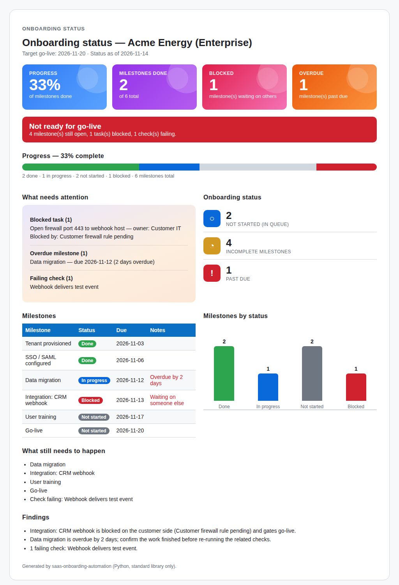

# saas-onboarding-automation

A small Python tool that reads a customer onboarding plan (JSON) and reports
what an implementation engineer needs before a go-live: which milestones are
done, which tasks are blocked or overdue, what is still missing, and a short
list of findings.

The way I use it: while I review an onboarding plan by hand, the tool runs
over the same plan in the background. When I finish, I compare its findings
against my own notes. It catches the blocker a tired human misses — the
integration waiting on a customer firewall rule, or the migration that
quietly went overdue.

Demo video (94 s): https://youtu.be/oTeflhP-T4s

## Features

- Milestone progress: counts and percentage, overdue milestones flagged
  against a reference date (`--as-of YYYY-MM-DD`, defaults to today)
- Blocked-task report: every blocked task with its `blocked_by` reason and
  owner, so you know exactly who to chase
- Go-live readiness: **READY** / **NOT READY**, listing every unfinished
  milestone, failing check, and blocked task standing in the way
- A findings section written for comparison against a manual review
- Text report by default, JSON with `--json`, report file with `--output`
- Visual HTML report with `--html`: one self-contained file (inline CSS,
  no JavaScript, no external resources) for CSMs and executives — dashboard
  style: stat cards, readiness banner, what needs attention, status summary,
  milestones table, and a bar chart, in plain language. Open it from disk
  or attach it to an email.
- Exit code 1 when NOT READY for go-live — plugs into CI or a checklist
  gate; exit code 0 when ready
- Standard library only — no dependencies, no installation step

## Usage

```bash
python3 onboarding.py sample_onboarding.json [--as-of YYYY-MM-DD] [--json] [--html] [--output report.html]
```

Share the visual report with non-technical stakeholders:

```bash
python3 onboarding.py sample_onboarding.json --html --output report.html
```

Try it on the bundled sample plan (a fictional mid-market onboarding,
target go-live Nov 20, 2026):

```bash
python3 onboarding.py sample_onboarding.json --as-of 2026-11-14
```

## Sample output

```text
Onboarding: Acme Energy (Enterprise) — target go-live 2026-11-20
================================================================
Milestones: 2 done, 1 in progress, 2 not started, 1 blocked of 6
Progress: 33%

Overdue milestones
------------------------------------------------------------
  Data migration — due 2026-11-12 (2 days overdue)

Blocked tasks
------------------------------------------------------------
  Open firewall port 443 to webhook host — owner: Customer IT
    Blocked by: Customer firewall rule pending

Go-live readiness: NOT READY
------------------------------------------------------------
  - Milestone not done: Data migration
  - Milestone not done: Integration: CRM webhook
  - Milestone not done: User training
  - Milestone not done: Go-live
  - Failing check: Webhook delivers test event
  - Blocked task: Open firewall port 443 to webhook host

Findings to compare against your own review
------------------------------------------------------------
  - Integration: CRM webhook is blocked on the customer side (Customer firewall rule pending) and gates go-live.
  - Data migration is overdue by 2 days; confirm the work finished before re-running the related checks.
  - 1 failing check: Webhook delivers test event.
```

The same report as a visual dashboard for CSMs and executives — stat cards,
readiness banner, what needs attention, status summary, milestones table,
and a bar chart:

- [sample_report.html](sample_report.html) — generated with
  `python3 onboarding.py sample_onboarding.json --as-of 2026-11-14 --html --output sample_report.html`



## Tests

```bash
python3 -m unittest discover -s tests
```
